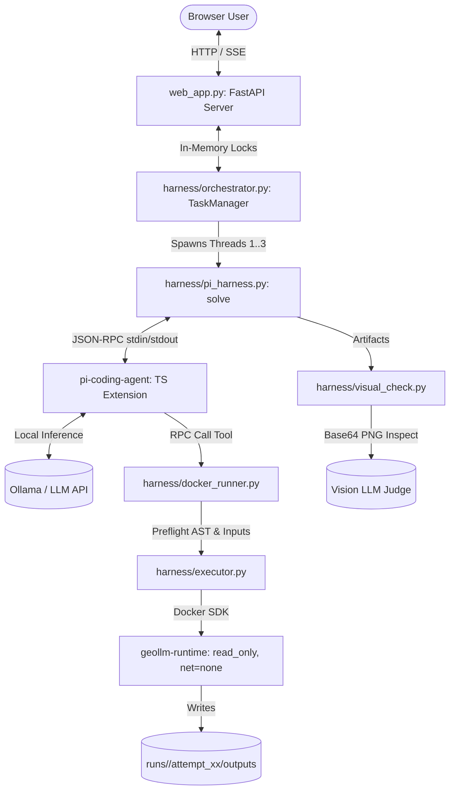
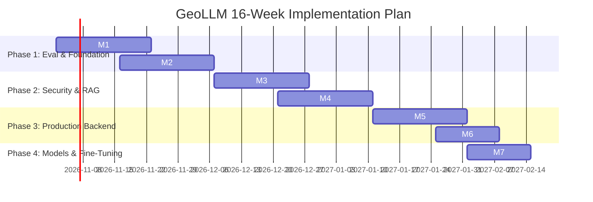

# GeoLLM: Strategic Upgrade Analysis & AI Engineering Blueprint
**Target Repository:** `geollm` (Astryx Autonomous Geospatial Workbench)  
**Authors:** Senior AI Engineer & Geospatial Architect  
**Scope:** Architectural audit, geospatial expansion, NVIDIA OpenShell integration, and 16-week production AI-engineering curriculum.

---

## 1. Current State Assessment

### Architecture Diagram


### Data Flow & Execution Pipeline
1. **Intake:** `web_app.py` receives query/files, invoking `TaskManager.submit_task()` (`orchestrator.py:145-185`).
2. **Context Build:** `pi_harness.py:43-54` inspects datasets via `inspect_dataset` and populates `pi_prompt.md`.
3. **Execution:** Pi RPC agent streams reasoning tokens and triggers `run_geospatial_code` in `docker_runner.py`.
4. **Containment:** `docker_runner.py:240-272` runs AST preflight checks; `executor.py:43-109` executes an ephemeral container (`network_mode="none"`, `mem_limit="2g"`, `pids_limit=128`, `read_only=True`, `cap_drop=["ALL"]`).
5. **Critique:** `docker_runner.py:70-115` validates outputs (`result.json`, GeoTIFFs, PNGs). If map figures exist, `visual_check.py:8-75` executes vision-based self-correction.

### Solid vs. Fragile
- **Solid:** Container isolation (`executor.py:84-91`), safe input path whitelisting (`docker_runner.py:30-49`), preflight AST rejection (`docker_runner.py:248-265`), and final successful attempt artifact isolation (`orchestrator.py:42-129`).
- **Fragile:**
  - *Plan Gate Substring Check (`docker_runner.py:266-271`):* Naive check `any(k in code_str for k in [".write(", "to_file(", "savefig"])` is easily bypassed via `getattr(rasterio, "open")(..., "w")`.
  - *In-Memory Single Process State (`orchestrator.py:17-40`):* `TaskState` instances live in Python memory with a single `threading.Lock`. Process crashes drop all active jobs and SSE telemetry.
  - *Prompt Injection via Metadata (`pi_harness.py:43-54`):* Untrusted GeoTIFF tags and CSV headers are interpolated into `pi_prompt.md` without boundary delimiters.
  - *Heuristic JSON Parsing (`visual_check.py:40-44`):* Vision model responses use loose regex; malformed markdown silently marks status as `"skipped"`.
- **Tech Debt & Testing:** Zero automated unit/integration test suites; unverified host memory headroom when running 3 concurrent containers (`MAX_TASKS=3`).

---

## 2. New Geospatial Capabilities (Beyond Remote Sensing)

| Domain | Task | Libraries | Sandbox Fit | Example Prompt | Diff. |
| :--- | :--- | :--- | :--- | :--- | :---: |
| **Vector** | Buffer, overlay, join, dissolve | `geopandas`, `shapely>=2.0` | **Full**: Offline memory vectors. | *"Find clinics within 5km of flood zones and sum affected population."* | **S** |
| **Terrain/Hydro** | Slope, aspect, watershed, accumulation | `richdem`, `whitebox` | **Full**: Local DEM rasters. | *"Calculate slope and delineate sub-basins from `dem_30m.tif` above 15% grade."* | **M** |
| **Network** | Isochrones, routing, accessibility | `osmnx`, `networkx` | **Requires Extract**: Mount local `.osm.pbf`. | *"Generate 15-minute evacuation isochrones from schools via road network."* | **M** |
| **Spatio-Temporal** | Trend, Mann-Kendall, anomaly | `xarray`, `rioxarray` | **Full**: Offline multi-temporal stacks. | *"Analyze monthly NDVI stacks from 2018-2024 to detect deforestation anomalies."* | **M** |
| **Geostatistics** | Kriging, IDW, Moran's I, HDBSCAN | `pykrige`, `esda`, `scikit-learn` | **Full**: Coordinate CSVs / GeoJSON. | *"Interpolate soil salinity across farms via ordinary kriging and map clusters."* | **M** |
| **LiDAR** | CHM, ground point classification | `laspy`, `open3d` | **Constrained**: High RAM; tiled mode. | *"Classify ground returns from `survey.laz` and create 1m Canopy Height Model."* | **L** |
| **Geocoding** | Offline address matching, gazetteer | `sqlite3`, `rapidfuzz` | **Requires DB**: Mount SQLite gazetteer. | *"Match incident reports with ambiguous village names against regional gazetteer."* | **L** |
| **Reporting** | Cartographic PDF synthesis with stats | `weasyprint`, `matplotlib` | **Full**: Template render from outputs. | *"Compile a 4-page audit PDF with situational maps, methodology, and uncertainty."* | **S** |

### Top 5 Recommended Capabilities (Prioritized)
1. **Vector Analysis:** Fundamental GIS core; minimal complexity; high utility for zoning and proximity.
2. **Spatio-Temporal Analysis:** Natural evolution of GeoLLM's multi-band imagery core; unlocks climate/deforestation monitoring.
3. **Terrain & Hydrology:** Critical for flood, infrastructure, and watershed management from elevation data.
4. **Point Data & Geostatistics:** Connects tabular sensor datasets (weather, pollution) to continuous rasters.
5. **Report Generation:** Converts raw analytical deliverables into auditable, executive-ready PDF artifacts.

---

## 3. AI-Engineering Upgrades

### a. GeoBench: Evaluation Suite & CI Gating
- **Design:** 80 curated tasks (40 public validation, 40 private held-out) with ground-truth rasters, vector geometries, and numerical tolerances.
- **Touched Files:** `tests/geobench/`, `harness/eval/metrics.py`, `.github/workflows/eval.yml`.
- **Metrics:** Pass@1, Pass@3, Spatial Agreement (IoU $\ge 0.85$, SSIM $\ge 0.90$), Token Count, Duration.
- **Judge Validation:** Evaluate `visual_check.py` against 200 human-annotated map images to benchmark Precision/Recall/F1 of vision critiques.
- **Learning Value:** Benchmark harness engineering, deterministic eval of non-deterministic models, CI gating.

### b. Domain PyTorch Models as In-Sandbox Tools
- **Design:** Pre-trained PyTorch models exported to ONNX/TorchScript, mounted read-only at `/workspace/models`:
  1. *Cloud & Shadow Masking:* MobileNetV3-UNet on CloudSEN12 (target: mIoU $\ge 0.88$, beats Fmask).
  2. *Hyperspectral Material Matcher:* 1D-CNN on USGS Spectral Library + EMIT data (target: Top-1 Acc $\ge 0.92$, beats SAM).
- **Touched Files:** `harness/models/`, `harness/executor.py` (mounts `/opt/models:ro`), `geollm_lib/ml.py`.
- **Dependencies:** `torchvision`, `onnxruntime`.
- **Learning Value:** Model export, ONNX runtime optimization, in-container model inference.

### c. Domain-Specific RAG & Skill Library
- **Design:** Hybrid retriever (BM25 + BGE-small dense embeddings + cross-encoder reranker) indexing:
  1. *Offline Docs:* `rasterio`, `geopandas`, `shapely`, `rioxarray`, `whitebox`.
  2. *Skill Library:* Verified working code snippets mined from successful previous runs.
- **Touched Files:** `harness/rag/`, `harness/docker_runner.py`.
- **Dependencies:** `lancedb`, `fastembed`, `rank-bm25`.
- **Ablation Plan:** Measure Pass@1 across (1) Base prompt, (2) BM25, (3) Dense, (4) Hybrid + Reranker.
- **Learning Value:** Enterprise RAG design, semantic caching, precision retrieval.

### d. Typed Tool Library vs. Free-Form Code
- **Design:** Pre-built Pydantic tools (`calculate_zonal_stats`, `reproject_raster`) vs. dynamic script generation.
- **Ablation:** Benchmark on GeoBench: (1) Free-form script only, (2) Typed tools only, (3) Hybrid router (typed primitives with free-form fallback).
- **Touched Files:** `geollm_lib/tools/`, `harness/pi_extension/geollm.ts`.
- **Learning Value:** Function-calling reliability vs. code-generation expressiveness trade-offs.

### e. Model Context Protocol (MCP) Server
- **Design:** FastMCP server exposing GeoLLM primitives to Claude Desktop and external multi-agent systems:
  - *Resources:* `geollm://datasets/{name}` (band schema, CRS, extent), `geollm://runs/{id}/artifacts`.
  - *Tools:* `submit_task`, `approve_plan`, `inspect_raster`.
- **Touched Files:** `mcp_server.py`, `harness/mcp_adapter.py`.
- **Dependencies:** `mcp>=1.0.0`.
- **Learning Value:** Modern standardized agent interoperability protocols.

### f. Agentic Fine-Tuning Pipeline (DPO & LoRA)
- **Design:** Trajectory harvester mining `runs/`:
  - *SFT Data:* Successful run traces `(Schema + Question -> Plan -> Script -> Output)`.
  - *DPO Pairs:* Self-corrected traces where attempt $N$ failed ($y_l$) and attempt $N+1$ succeeded ($y_w$).
  - *Training:* LoRA fine-tuning on `Qwen2.5-Coder-7B-Instruct` via Unsloth/TRL.
  - *When NOT to Fine-Tune:* Changing library APIs or data schemas where prompt updates suffice.
- **Touched Files:** `scripts/curate_training_data.py`, `train/train_lora.py`.
- **Learning Value:** Preference alignment (DPO), LoRA parameter-efficient training, data flywheel.

### g. Planner Architecture & Context Engineering
- **Design:** Replace substring check with structured Pydantic plan schema (hypotheses, steps, RAM budget, outputs). Static AST validator verifies generated script matches approved plan before container launch. Token-budgeted sliding window for SSE logs.
- **Touched Files:** `harness/plan.py`, `harness/docker_runner.py:240-272`.
- **Dependencies:** `pydantic>=2.0`.
- **Learning Value:** Plan-and-solve agent patterns, AST static analysis, context window budgeting.

### h. Production Reliability Architecture
- **Design:** Replace in-memory `TaskState` with PostgreSQL + SQLAlchemy. Decouple task execution from FastAPI using Redis + ARQ queue. Implement task idempotency via input/prompt hash.
- **Touched Files:** `db/models.py`, `db/session.py`, `harness/worker.py`, `web_app.py`.
- **Dependencies:** `sqlalchemy`, `alembic`, `redis`, `arq`.
- **Learning Value:** Distributed job queues, transactional state persistence, fault recovery.

### i. Observability & Telemetry
- **Design:** OpenTelemetry instrumentation for end-to-end trace waterfalls (FastAPI -> LLM -> Sandbox -> Vision). Langfuse integration for token/cost tracking. Prometheus exporter for Docker OOM/duration metrics.
- **Touched Files:** `harness/telemetry.py`, `web_app.py`.
- **Dependencies:** `opentelemetry-api`, `langfuse`, `prometheus-fastapi-instrumentator`.
- **Learning Value:** Production LLM observability, distributed tracing, metrics alerting.

### j. Security & NVIDIA OpenShell Integration
- **NVIDIA OpenShell Strategic Adoption:**
  - *Role:* Replaces bespoke Docker runner with an enterprise-grade agent runtime governing actions across time, not just single-container execution.
  - *Architecture:*
    ```mermaid
    graph LR
        SubAgent[GeoLLM Agent] --> Gateway[OpenShell Gateway & Policy Prover]
        Gateway -->|Policy-as-Code| Sup[OpenShell Supervisor]
        Sup -->|Landlock LSM + seccomp| Sandbox[Isolated Worker Sandbox]
        Sup -->|Inference Router| LocalLLM[(Ollama / Local NIM)]
        Gateway -->|Audit Log| Prov[Signed Provenance Manifest]
    ```
  - *Policy-as-Code:* Declarative rules enforcing read-only datasets, restricted output writes, and zero network egress, formally checked by OpenShell's policy prover.
  - *Secret Shielding:* Supervisor brokers credentials; container processes never see raw tokens.
  - *Prompt Injection Red-Teaming:* Security test suite injecting adversarial payloads into GeoTIFF EXIF, GeoJSON properties, and CSV metadata.
- **Touched Files:** `openshell.yaml`, `harness/executor.py`, `tests/security/test_injection.py`.
- **Learning Value:** Linux Landlock LSM, seccomp filters, policy-as-code, adversarial LLM defense.

### k. CI/CD Pipeline
- **Design:** GitHub Actions matrix running `ruff` (lint/format), `mypy` (strict types), fast unit tests (mocked Docker), and a 5-task GeoBench smoke eval on PRs.
- **Touched Files:** `.github/workflows/ci.yml`, `pyproject.toml`.
- **Learning Value:** Automated test gating, static typing enforcement, regression prevention.

---

## 4. Prioritized 16-Week Implementation Roadmap



### Milestone Specifications

| Milestone | Deliverables | Acceptance Criteria | Target Metric | Est. Hours | Risks |
| :--- | :--- | :--- | :--- | :---: | :--- |
| **M1: GeoBench (W1-3)** | 60 tasks + eval runner | Deterministic grading running in CI | Pass@1 baseline recorded | 45h | Large rasters; mitigate via Git LFS |
| **M2: Vector/Hydro (W3-5)** | Container with `geopandas`, `richdem` | Buffers, overlays, DEM slopes pass | $\ge 90\%$ pass on 20 vector tasks | 40h | C++ binary compatibility in Linux Docker |
| **M3: OpenShell (W6-8)** | OpenShell policy + injection tests | Formal policy prover blocks host writes | 100% injection tests caught | 50h | OpenShell setup complexity on WSL2 |
| **M4: RAG Engine (W8-10)** | LanceDB GIS docs + Skill Library | Hybrid retrieval augments agent prompt | $\ge 40\%$ drop in syntax errors | 45h | Outdated library docs causing hallucination |
| **M5: Prod Backend (W11-13)** | Postgres DB, Redis queue, OTel spans | Server crash recovery; full traces visible | Zero lost tasks on restart | 55h | Complex distributed async state sync |
| **M6: MCP Server (W13-14)** | FastMCP server for tasks and tools | Claude Desktop submits and tracks tasks | 100% MCP spec compliance | 25h | SSE bridge translation edge cases |
| **M7: PyTorch & LoRA (W14-16)** | ONNX cloud tool + LoRA fine-tuning | Fine-tuned 7B model beats base model | $+15\%$ relative Pass@1 gain | 50h | Local GPU VRAM constraints |

### Defer / Skip List
- **Defer LiDAR (LAS/LAZ):** Point clouds require massive RAM allocations and 3D indexing; defer to post-M7.
- **Defer Road Network Routing:** Extracting routable OSM graphs offline requires multi-GB files; defer to post-M7.
- **Skip Cloud Object Storage (S3/GCS):** GeoLLM’s differentiator is 100% offline local privacy; keep local disk/Postgres.

---

## 5. AI-Engineering Learning Map

| AI-Engineering Skill | GeoLLM Feature | Key Competency | Authoritative Resource |
| :--- | :--- | :--- | :--- |
| **FastAPI & Async Python** | Postgres + Redis Worker Queue | Async event loops, SSE streams, background workers | *Architecture Patterns with Python* (Percival & Gregory) |
| **ML & PyTorch** | In-Sandbox ONNX Tool (`geollm_lib/ml.py`) | Model export, ONNX runtime, raster tensor pipeline | *Deep Learning with PyTorch* (Stevens et al.) |
| **Local LLM Serving** | Ollama / vLLM local orchestration | Quantization (GGUF/AWQ), KV-caching, inference latency | Hugging Face *NLP Course* (huggingface.co/learn) |
| **Advanced RAG** | Offline Docs & Skill Index (LanceDB) | Hybrid BM25/Dense search, cross-encoder reranking | *Dense Retrieval for Open-Domain QA* (Karpukhin et al.) |
| **Agent Protocols & MCP** | GeoLLM FastMCP Server (`mcp_server.py`) | Model Context Protocol, tool schemas, resource URIs | Model Context Protocol Spec (modelcontextprotocol.io) |
| **Evals & Benchmarking** | GeoBench Suite (`tests/geobench/`) | Pass@k, automated grading, ground-truth IoU/SSIM | *Evaluating LLMs* (Eugene Yan) |
| **Fine-Tuning (DPO/LoRA)** | Trajectory DPO (`train/train_lora.py`) | Preference optimization, LoRA adapters, dataset curation | *Direct Preference Optimization* (Rafailov et al., 2023) |
| **LLMOps & Tracing** | OpenTelemetry & Langfuse Integration | Distributed tracing, latency waterfall, prompt versioning | OpenTelemetry Python Docs (opentelemetry.io) |
| **Agent Security & Runtime** | NVIDIA OpenShell + Landlock LSM | Kernel sandboxing, policy-as-code, prompt injection | NVIDIA OpenShell Docs & Linux Landlock Guide |

---

## 6. Risks, Constraints & Open Questions

### Constraints & Edge Cases
1. **GPU VRAM Ceiling:** Host runs local Ollama on Windows. Concurrently running LLM + Vision LLM + PyTorch tools + Docker requires 16GB–24GB VRAM. *Mitigation:* Sequence tool execution so PyTorch inference occurs only after LLM generation finishes.
2. **NVIDIA OpenShell Host Requirements:** OpenShell relies on Linux kernel primitives (Landlock LSM, seccomp). On Windows workstations, OpenShell must run inside a Linux guest (WSL2 or Docker Desktop WSL2 backend).
3. **Data Licensing:** Sentinel-2 and Landsat data are open access (CC-BY). Verify licensing of third-party GIS shapefiles before bundling into GeoBench public validation sets.

### Questions for User
1. *Hardware Specs:* What GPU model and VRAM capacity are available on your development machine?
2. *Deployment Target:* Is GeoLLM intended strictly as a single-user local workstation desktop tool, or will it be deployed onto on-premises multi-user Linux servers?
3. *IP & Open Source:* Can the GeoBench benchmark tasks and fine-tuning datasets be released as open source, or must they remain proprietary to Stellaria?

---

## 7. First 7 Days Action Checklist

- [ ] **Day 1: Baseline Test Harness Setup**
  - Create directory `tests/geobench/`. Write first 3 automated tests (NDVI calculation, water index threshold, spectral band ratio).
  - Verify deterministic automated grading comparing container raster output against ground-truth GeoTIFF via `numpy.testing.assert_allclose`.
- [ ] **Day 2: Record Baseline Metrics**
  - Run the 3 test cases 5 times against current Ollama model. Record baseline Pass@1, duration, and token usage.
- [ ] **Day 3: Sandbox Security Audit**
  - Write a test script attempting to bypass plan approval using dynamic Python imports (`__import__('rasterio').open(...)`). Document failure.
- [ ] **Day 4: NVIDIA OpenShell WSL2 Setup**
  - Install and verify NVIDIA OpenShell inside WSL2 Ubuntu environment. Test basic sandbox container isolation with zero network egress.
- [ ] **Day 5: Vector Library Environment Build**
  - Add `geopandas`, `shapely`, and `pyarrow` to `geollm-runtime` Dockerfile. Rebuild and verify container size and startup latency.
- [ ] **Day 6: First Vector Analysis Task**
  - Create GeoBench Task #4: *Buffer hospital points by 2km and compute intersection with flood hazard shapefile*. Run agent against it.
- [ ] **Day 7: Sprint Review & Milestone Planning**
  - Review Pass@1 across the 4 initial tasks. Commit `docs/UPGRADE_ANALYSIS.md` to repository. Lock in Milestone 1 sprint goals.
