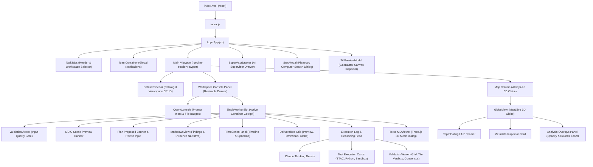
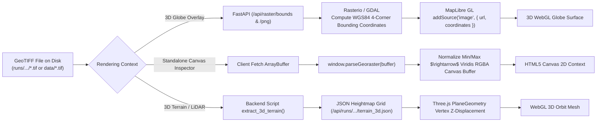
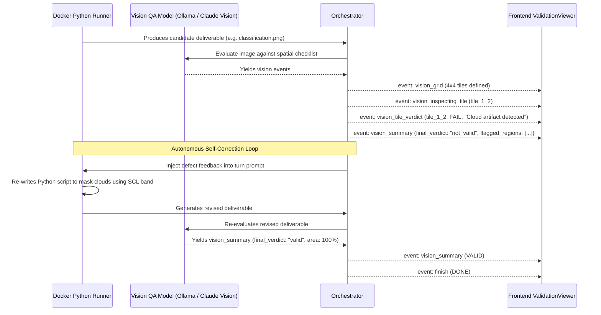

# GeoLLM Frontend Architecture & Codebase Audit Report (`frontend.md`)

*Document Version:* 1.0.0  
*Date of Audit:* November 2026  
*Target Environment:* GeoLLM (Astryx Autonomous Geospatial Workbench)  
*Status:* Complete Codebase Audit & Architectural Reference  

---

## Table of Contents
1. [Executive Summary & System Purpose](#1-executive-summary--system-purpose)
2. [Frontend Architecture & Technology Stack](#2-frontend-architecture--technology-stack)
   - [2.1 Technology Stack & Runtime Environment](#21-technology-stack--runtime-environment)
   - [2.2 Project Structure & File Map](#22-project-structure--file-map)
   - [2.3 Component Hierarchy & Composition](#23-component-hierarchy--composition)
   - [2.4 State Management & Data Lifecycles](#24-state-management--data-lifecycles)
   - [2.5 Design System & Styling Architecture](#25-design-system--styling-architecture)
3. [Deep-Dive: User-Visible Features & Capabilities](#3-deep-dive-user-visible-features--capabilities)
   - [3.1 Main Application Shell & Responsive Workbench](#31-main-application-shell--responsive-workbench)
   - [3.2 Dynamic Workspace Management & Container Allocation](#32-dynamic-workspace-management--container-allocation)
   - [3.3 Dataset Catalog & Storage Sidebar](#33-dataset-catalog--storage-sidebar)
   - [3.4 Query Console & Task Dispatcher](#34-query-console--task-dispatcher)
   - [3.5 Worker Slot Workbench & Live Execution Feed](#35-worker-slot-workbench--live-execution-feed)
   - [3.6 MapLibre GL 3D Globe & Geospatial Overlays](#36-maplibre-gl-3d-globe--geospatial-overlays)
   - [3.7 Microsoft Planetary Computer STAC Search & Staging](#37-microsoft-planetary-computer-stac-search--staging)
   - [3.8 Vision QA Feedback & Self-Correction Pipeline](#38-vision-qa-feedback--self-correction-pipeline)
   - [3.9 Three.js Interactive 3D Terrain & LiDAR Canopy Viewer](#39-threejs-interactive-3d-terrain--lidar-canopy-viewer)
   - [3.10 Time-Series Animation & Temporal Sparkline Panel](#310-time-series-animation--temporal-sparkline-panel)
   - [3.11 Standalone GeoTIFF Canvas Viewer (GeoRaster)](#311-standalone-geotiff-canvas-viewer-georaster)
   - [3.12 AI Supervisor Drawer & Telemetry Hub](#312-ai-supervisor-drawer--telemetry-hub)
   - [3.13 Global In-App Toast Notification System](#313-global-in-app-toast-notification-system)
4. [Comprehensive Frontend Feature Inventory](#4-comprehensive-frontend-feature-inventory)
5. [Frontend-to-Backend Data Flow & Communication Specifications](#5-frontend-to-backend-data-flow--communication-specifications)
   - [5.1 Task Submission & Execution Lifecycle Diagram](#51-task-submission--execution-lifecycle-diagram)
   - [5.2 Complete SSE Event Protocol (`/api/tasks/{id}/stream`)](#52-complete-sse-event-protocol-apitasksentrystream)
   - [5.3 REST API Endpoints Specification](#53-rest-api-endpoints-specification)
   - [5.4 Geospatial Data Delivery: GeoTIFF on Disk to WebGL/Canvas](#54-geospatial-data-delivery-geotiff-on-disk-to-webglcanvas)
   - [5.5 Vision Feedback & Re-Planning Data Loop](#55-vision-feedback--re-planning-data-loop)
6. [Gaps, Inconsistencies, Dead Code & Failure Modes](#6-gaps-inconsistencies-dead-code--failure-modes)
   - [6.1 Dead Code & Unreferenced Components](#61-dead-code--unreferenced-components)
   - [6.2 Compilation & Dual-Extension Discrepancies (`.jsx` vs `.js`)](#62-compilation--dual-extension-discrepancies-jsx-vs-js)
   - [6.3 External CDN Runtime Vulnerabilities](#63-external-cdn-runtime-vulnerabilities)
   - [6.4 State Persistence & Mid-Run Failure Recovery Gaps](#64-state-persistence--mid-run-failure-recovery-gaps)
   - [6.5 Error Handling & Missing UI States](#65-error-handling--missing-ui-states)
7. [Production Modernization Roadmap (Vite + `shadcn/ui`)](#7-production-modernization-roadmap-vite--shadcnui)

---

## 1. Executive Summary & System Purpose

GeoLLM (also identified as the **Astryx Autonomous Geospatial Workbench**) is a specialized, production-grade web application engineered for geospatial intelligence, environmental monitoring, satellite remote sensing, and automated raster analysis.

Unlike traditional GIS software (e.g., ArcGIS, QGIS) which requires manual workflow creation, or generic LLM code assistants that lack deterministic execution sandboxes, GeoLLM bridges natural language instructions with **offline, zero-network Docker execution sandboxes** (`task_1`, `task_2`, `task_3`).

The frontend functions as an operator cockpit. It provides:
1. **Real-time execution observability**: Streaming Python agent reasoning traces, subprocess tool executions, and step-by-step progress via Server-Sent Events (SSE).
2. **Human-in-the-loop safeguards**: Mandatory review gates for high-level execution roadmaps and STAC satellite acquisition plans.
3. **Multi-dimensional geospatial visualization**:
   - A full **3D MapLibre WebGL globe** with dynamic raster reprojection and user-drawn Areas of Interest (AOI).
   - A high-performance **Three.js 3D mesh engine** for Digital Elevation Models (DEMs) and LiDAR Canopy Height Models (CHMs).
   - A browser-native **HTML5 canvas GeoTIFF engine** powered by `georaster` for client-side contrast stretching and color ramping.
   - Synchronized **time-series frame players** for spatio-temporal change detection (e.g., Basra agricultural expansion, flood inundation tracking).
4. **Agentic Vision Quality Assurance**: A dedicated visual inspection feedback loop that renders input quality gates, spatial sub-grid inspections, tile thumbnails, defect verdicts, and consensus validation.

---

## 2. Frontend Architecture & Technology Stack

### 2.1 Technology Stack & Runtime Environment

The frontend employs a lightweight, browser-native ES Module (ESM) architecture layered with React 18 and WebGL visualization libraries without requiring a runtime Node.js server.

```mermaid
graph TD
    subgraph Browser Runtime
        IndexHtml["templates/index.html"] --> VendorLibs["Third-Party CDN & Vendor Scripts"]
        VendorLibs --> MapLibre["MapLibre GL JS v4.7.1<br/>(3D Globe & GeoJSON Layers)"]
        VendorLibs --> ThreeJS["Three.js r160<br/>(3D DEM & LiDAR Mesh)"]
        VendorLibs --> GeoRaster["GeoRaster v1.6.0<br/>(Client-Side GeoTIFF Parser)"]
        VendorLibs --> Marked["marked.umd.js<br/>(Markdown Parsing)"]
        
        IndexHtml --> ReactRoot["static/js/index.js (ESM)"]
        ReactRoot --> ReactEsm["https://esm.sh/react@18.2.0"]
        ReactRoot --> AppComp["static/js/App.js (Compiled from App.jsx)"]
        AppComp --> Components["Component Tree (JSX / HTML Tagged Literals)"]
    end
    
    subgraph Backend Server (FastAPI)
        Uvicorn["web_app.py (FastAPI / Uvicorn)"]
        Uvicorn -->|HTML / Static Assets| IndexHtml
        Uvicorn -->|SSE Event Stream /api/tasks/{id}/stream| AppComp
        Uvicorn -->|REST JSON Endpoints| Components
        Uvicorn -->|Static Mount /runs, /data| MapLibre
    end
```

| Layer | Technology | Version | Loading Mechanism | Purpose |
| :--- | :--- | :--- | :--- | :--- |
| **Framework** | React | `18.2.0` | ESM CDN (`https://esm.sh/react@18.2.0`) | Client-side reactive UI rendering and state management. |
| **DOM Renderer** | React DOM / Client | `18.2.0` | ESM CDN (`https://esm.sh/react-dom@18.2.0/client`) | React 18 concurrent root rendering (`createRoot`). |
| **Tagged Template Binding** | HTM (Hyperscript Tagged) | `3.1.1` | ESM CDN (`https://esm.sh/htm@3.1.1`) | Allows JSX-like syntax in pure `.js` files via tagged template literals. |
| **Mapping Engine** | MapLibre GL JS | `4.7.1` | Global script (`https://unpkg.com/maplibre-gl@4.7.1`) | 3D Globe projection, ESRI satellite basemap, bounding box drawing, raster overlays. |
| **3D Mesh Engine** | Three.js | `0.160.0` | Global script (`https://unpkg.com/three@0.160.0`) | 3D terrain elevation models, LiDAR canopy point clouds, transect cross-sections. |
| **Raster Analysis** | GeoRaster | `1.6.0` | Global script (`https://unpkg.com/georaster@1.6.0`) | Client-side binary GeoTIFF parsing and canvas pixel rendering without GIS servers. |
| **Markdown Parser** | Marked | Pinned Local | Pinned script (`/static/js/vendor/marked.umd.js`) | Rendering agent plans, markdown findings, and LLM reasoning logs safely. |
| **Styling** | Astryx CSS Design System | Custom | Static stylesheet (`/static/css/astryx.css`) | Technical dark-mode theme, HUD toolbars, split-pane layout, animations. |
| **Typography** | IBM Plex Sans & Mono | Google Fonts | Web font stylesheet | Technical cockpit typography optimized for telemetry data. |

---

### 2.2 Project Structure & File Map

```
geollm/
├── templates/
│   └── index.html                          # Main HTML shell, font links, global vendor script tags
├── static/
│   ├── css/
│   │   └── astryx.css                      # Design system stylesheet (~2,500 lines)
│   └── js/
│       ├── index.js                        # Client bootstrap & createRoot mounting
│       ├── html.js                         # HTM tagged template literal adapter (htm.bind(React.createElement))
│       ├── icons.js                        # SVG icon library definitions
│       ├── App.jsx / App.js                # Top-level application container, state hub, SSE dispatcher
│       ├── components/
│       │   ├── TaskTabs.jsx / .js          # Top header bar, workspace tabs, container allocation pills
│       │   ├── DatasetSidebar.jsx / .js    # Data catalog explorer, search/filtering, file upload, workspace manager
│       │   ├── QueryConsole.jsx / .js      # Natural language prompt console, dataset attachment chips
│       │   ├── SingleWorkerSlot.jsx / .js  # Primary active slot workbench, gates, plans, deliverables, logs
│       │   ├── GlobeView.jsx / .js         # MapLibre GL 3D Globe, AOI drawing, overlays, metadata inspector
│       │   ├── StacModal.js                # Microsoft Planetary Computer STAC search & staging modal
│       │   ├── SupervisorDrawer.js         # Supervisor AI telemetry stream & prompt dispatch drawer
│       │   ├── Terrain3DViewer.js          # Three.js 3D terrain & LiDAR mesh modal viewer
│       │   ├── TimeSeriesPanel.js          # Temporal frame player, sparkline chart, timeline playback
│       │   ├── TiffPreviewModal.js         # Standalone Canvas GeoTIFF viewer (GeoRaster)
│       │   ├── ValidationViewer.js         # Agentic vision QA inspection feedback cards
│       │   ├── Toast.js                    # In-app toast notification alert system
│       │   ├── MarkdownView.js             # Wrapper for marked.umd.js parser
│       │   └── [REMOVED] Navbar, UnifiedChat, WorkerSlots (Purged dead legacy components)
│       └── vendor/
│           ├── marked.umd.js               # Standalone UMD Marked bundle
│           └── marked.esm.js               # ESM version of Marked bundle
└── web_app.py                              # FastAPI backend serving static files & API routes
```

---

### 2.3 Component Hierarchy & Composition



---

### 2.4 State Management & Data Lifecycles

The application implements a hybrid state architecture:
1. **Application-Level State (`App.jsx`)**:
   - `workspaces`: Array of user-created workspaces (`[{ id, name, containerId, createdAt }]`). Persisted automatically to `localStorage('geollm_workspaces')`.
   - `activeWorkspaceId`: String identifier of currently active workspace.
   - `consoleWidth`: Width in pixels of the docked workspace console (default: `480px`, clamp: `360px` to `window.innerWidth - 360px`). Persisted to `localStorage('geollm_console_width')`.
   - `tasks`: Hash map of container states for `task_1`, `task_2`, and `task_3`. Each container state contains:
     ```typescript
     interface TaskState {
       status: 'idle' | 'running' | 'pending_approval' | 'pending_stac_approval' | 'done' | 'failed';
       question: string;
       step: string;
       elapsed: number;
       plan: string | null;
       stacPreview: StacPreviewPayload | null;
       artifacts: Array<Artifact | string>;
       attempt: number | null;
       code_attempt?: number;
       max_attempts?: number;
       activities: ActivityEvent[];
       answer?: string | null;
       error?: string | null;
     }
     ```
   - `feedItems`: High-level event stream displayed in the AI Supervisor telemetry tab.
   - `activeAoiBbox`: Four-coordinate geographic bounding box `[min_lon, min_lat, max_lon, max_lat]` drawn by the user on the 3D globe.
   - `pendingGlobeArtifact`: Pointer to a GeoTIFF artifact triggered by the user to overlay onto the MapLibre globe.
2. **Real-Time Stream State (`EventSource`)**:
   - Dedicated `EventSource` connections maintained per active container: `/api/tasks/{task_id}/stream`.
   - Stored in React ref: `streamsRef.current[taskId]`.
   - Transient network reconnects handled natively by browser EventSource. Auto-closed on terminal states (`done`, `failed`, `partial`).
3. **Fallback Polling Loop**:
   - Background interval running every 5,000 ms (`setInterval`).
   - Polls `GET /api/tasks` to recover task state if SSE drops packets or disconnects prematurely.
   - Concurrently triggers `GET /api/tasks/{task_id}/artifacts` for running or terminal containers to update deliverables.

---

### 2.5 Design System & Styling Architecture

The application is styled with **Astryx CSS** (`/static/css/astryx.css`), a tailored dark-theme design system.

#### Color Palette
- **Backgrounds**: Deep cockpit charcoal `#070A0F`, `#0B0F17`, and surface cards `#111827`.
- **Borders & Dividers**: High-contrast slate `#1E293B` and `#334155`.
- **Primary Accent (Teal)**: `#0F766E` (base), `#14B8A6` (bright) — indicates system ready, brand identity, vector overlays, and approvals.
- **Secondary Accent (Sky Blue)**: `#0284C7` (base), `#38BDF8` (bright) — indicates active telemetry, STAC operations, running tools, and coordinates.
- **Success (Emerald)**: `#10B981` — indicates clean exit codes, PASS verdicts, and completed deliverables.
- **Warning / Pending (Amber)**: `#F59E0B` — indicates user review requirements, cloudy satellite imagery, and non-blocking issues.
- **Danger (Rose/Red)**: `#EF4444` / `#F87171` — indicates sandbox errors, quality gate failures, task cancellations, and abort actions.

#### Split-Pane Resizing Mechanics
In [`App.jsx`](file:///d:/My%20Programmes/Internship/Stellaria/geollm/static/js/App.jsx#L46-L76), split-pane resizing mimics native IDEs:
```javascript
const handleStartConsoleResize = (e) => {
  e.preventDefault();
  setIsResizingConsole(true);
  const onMouseMove = (moveEvent) => {
    const maxAllowed = Math.max(480, window.innerWidth - 360);
    const nextWidth = Math.min(Math.max(moveEvent.clientX - 330, 360), maxAllowed);
    setConsoleWidth(nextWidth);
  };
  // Cleans up event listeners and persists to localStorage on mouseup
};
```

---

## 3. Deep-Dive: User-Visible Features & Capabilities

### 3.1 Main Application Shell & Responsive Workbench
- **Top Header Bar ([`TaskTabs.jsx`](file:///d:/My%20Programmes/Internship/Stellaria/geollm/static/js/components/TaskTabs.jsx))**:
  - Displays system brand `GeoLLM Autonomous`.
  - Displays container allocation counter pill (`Containers: X / 3 Allocated`).
  - Renders dynamic workspace navigation tabs with real-time status indicator dots and badges (`Idle`, `Running` with pulsating glow, `Review Plan`, `STAC Review`, `Done`, `Failed`).
  - Action buttons: Toggle Workspace Console (`💬 Workspace Console`), Search Planetary Computer STAC (`🛰️ STAC Catalog`), and Open AI Supervisor (`🤖 Supervisor AI`).
- **Main Viewport Layout**:
  - Left: Fixed 330px Data Catalog & Workspace Sidebar.
  - Center: Resizable, collapsible Workspace Console (docked at `left: 330px`, width defaults to 480px).
  - Right: Full-width, always-on MapLibre 3D Globe viewport.

---

### 3.2 Dynamic Workspace Management & Container Allocation
- **Dynamic Naming**: Users can create custom named workspaces (e.g., "Dubai Flood SAR", "Basra Agriculture NDVI") rather than dealing with raw container IDs.
- **Container Allocation Logic**:
  - Maximum of 3 concurrent workspaces.
  - Automatically maps to available Docker sandboxes: `task_1`, `task_2`, or `task_3`.
  - When all 3 containers are allocated, shows warning toast and disables creation.
- **Workspace Deletion**:
  - Deleting a workspace prompts the backend (`POST /api/tasks/{containerId}/reset`).
  - Closes active SSE streams, resets local container state to `idle`, frees the sandbox slot, and removes the workspace from `localStorage`.

---

### 3.3 Dataset Catalog & Storage Sidebar
- **Catalog Explorer ([`DatasetSidebar.jsx`](file:///d:/My%20Programmes/Internship/Stellaria/geollm/static/js/components/DatasetSidebar.jsx))**:
  - Fetches files from `GET /api/files`.
  - Classifies datasets dynamically:
    - `GeoTIFF Raster` (`.tif`, `.tiff`, `.jp2`, `.img`, `.vrt`)
    - `Vector Data` (`.geojson`, `.shp`, `.kml`, `.gpkg`, `.csv`, `.json`)
    - `LiDAR Point Cloud` (`.laz`, `.las`)
    - `Archive` (`.zip`, `.tar`, `.gz`)
  - Displays file metadata: basename, size in MB, and last modified date.
- **Search & Filter Tabs**:
  - Filter pills: `All`, `Raster`, `Vector`, `Other`.
  - Real-time text search filtering against file names and format tags.
  - Bulk actions: `Select All Filtered` button and `Clear Selection`.
- **Direct File Upload**:
  - Drag-and-drop or file picker uploading to `POST /api/upload`.
  - Refreshes catalog immediately upon upload completion.

---

### 3.4 Query Console & Task Dispatcher
- **Natural Language Prompting ([`QueryConsole.jsx`](file:///d:/My%20Programmes/Internship/Stellaria/geollm/static/js/components/QueryConsole.jsx))**:
  - Multi-line textarea for complex analytical queries.
  - Keyboard shortcut: <kbd>Ctrl</kbd> + <kbd>Enter</kbd> (or <kbd>Cmd</kbd> + <kbd>Enter</kbd>) for instant task dispatch.
- **Context Attachment Badges**:
  - Selected files appear as dismissible teal chips with `✕` removal buttons.
  - If no files are selected, displays the prominent **Autonomous STAC Mode** badge:
    `🛰️ Autonomous STAC Mode — Agent will search & preview satellite imagery for your query`.
- **Submission Action**:
  - Dispatches `POST /api/tasks` with `{ question, files, task_id, bbox }`.
  - Auto-allocates an available container sandbox if no workspace was selected.

---

### 3.5 Worker Slot Workbench & Live Execution Feed
Located in [`SingleWorkerSlot.jsx`](file:///d:/My%20Programmes/Internship/Stellaria/geollm/static/js/components/SingleWorkerSlot.jsx), this is the primary cockpit for an active task.

1. **Task Header Card**:
   - Container badge (`#1`, `#2`, `#3`), user prompt text, live elapsed time counter (`MM:SS`), and status pill.
   - **Abort Task** button: Immediately sends `POST /api/tasks/{id}/cancel` to kill Docker execution.
2. **Input Quality Gate Status Card**:
   - Renders if `vision_input_gate` activity occurs.
   - Evaluates input rasters for NoData percentage, cloud obstruction, and spatial bounds before wasting compute.
3. **Autonomous STAC Satellite Preview Banner**:
   - Shown when `status === 'pending_stac_approval'`.
   - Displays scene acquisition thumbnails, platform collection, capture dates, cloud cover %, and native grid resolution estimates.
   - Action buttons: `✓ Approve & Stage Native-Resolution Images` or text input for revision feedback (e.g., "Too cloudy, search July 2024 instead").
4. **Plan Approval Gate**:
   - Shown when `status === 'pending_approval'`.
   - Pauses execution and displays the agent's proposed Python execution roadmap.
   - Action buttons: `✓ Approve Plan & Execute Analysis` or revision feedback submission.
5. **Findings & Evidence Card**:
   - Shown on task completion or failure.
   - Formats the agent's scientific report in GitHub Flavored Markdown.
6. **Generated Deliverables Section**:
   - Interactive grid of generated artifacts (GeoTIFFs, PNG figures, GeoJSONs, CSVs).
   - Deliverable chips provide:
     - `Preview` (Opens raster in canvas viewer or image preview).
     - `Download` (Direct browser download link).
     - `🌍 Overlay on 3D Globe` (Immediately projects raster onto MapLibre globe).
     - `🌲 View 3D LiDAR & Canopy` / `🏔️ View 3D Terrain` (Triggers Three.js viewer).
7. **Live Execution & Reasoning Activity Feed**:
   - Auto-scrolling telemetry feed (respects user scroll-up intent).
   - Collapsible **Claude Thinking / Reasoning Log**: Displays token-by-token thought traces with word and character counts.
   - **Tool Execution Cards**: Displays tool name (`run_sandbox_python_code`, `search_stac`, `propose_stac_scenes`), execution duration in seconds, exit codes, attempt counter (`att 1/3`), expandable syntax-highlighted Python code, and standard output/error logs.

---

### 3.6 MapLibre GL 3D Globe & Geospatial Overlays
Implemented in [`GlobeView.jsx`](file:///d:/My%20Programmes/Internship/Stellaria/geollm/static/js/components/GlobeView.jsx) using MapLibre GL JS v4:
- **Globe Projection**: Uses `map.setProjection({ type: 'globe' })` with ESRI World Imagery satellite tiles and atmospheric sky fog.
- **Interactive AOI Bounding Box Drawing**:
  - `Draw AOI Bounding Box` button enters draw mode (`cursor: crosshair`).
  - User clicks and drags on the 3D globe surface; generates real-time GeoJSON polygon.
  - Automatically calculates bounding box `[min_lon, min_lat, max_lon, max_lat]` and computed surface area in $\text{km}^2$.
  - AOI Actions:
    - `✕ Clear AOI` (<kbd>Esc</kbd> shortcut).
    - `🛰️ Retrieve Satellite Data`: Transfers AOI directly to STAC search dialog.
    - `⚡ Send to Workspace`: Attaches AOI coordinates to active container prompt.
- **Dynamic Metadata Inspector**:
  - Floating HUD panel displaying real-time coordinates: Footprint, Surface Area ($\text{km}^2$), Center Point, Coordinate Reference System (CRS), Pixel Resolution, Acquisition Date, Satellite Platform, and Cloud Cover.
- **Analysis Overlays Stack**:
  - Overlays raster artifacts onto the globe via `/api/raster/bounds` and `/api/raster/png`.
  - Global raster opacity slider ($0\%$ to $100\%$).
  - Per-layer `🔍 Zoom to Extent` button using `map.fitBounds()`.

---

### 3.7 Microsoft Planetary Computer STAC Search & Staging
Implemented in [`StacModal.js`](file:///d:/My%20Programmes/Internship/Stellaria/geollm/static/js/components/StacModal.js):
- **Collections Supported**: `sentinel-2-l2a`, `sentinel-1-rtc`, `landsat-c2-l2`, `cop-dem-glo-30`, `naip`.
- **Modality Filtering**: Quick-select modality pills (`All`, `Optical`, `SAR Radar`, `Elevation DEM`).
- **Query Controls**:
  - Four-coordinate bounding box input (auto-populated from Globe AOI).
  - Date range picker (ISO format `YYYY-MM-DD` with automatic day/month ordering correction).
  - Maximum cloud cover slider ($0\%$ to $100\%$).
- **Live Staging & Real-Time Download Progress**:
  - Background polling loop queries `GET /api/stac/downloads` every 500 ms while modal is open.
  - Displays real-time progress bar, downloaded megabytes, and transfer speeds.
  - User can cancel individual band downloads or trigger `Cancel All Active Downloads`.

---

### 3.8 Vision QA Feedback & Self-Correction Pipeline
Implemented in [`ValidationViewer.js`](file:///d:/My%20Programmes/Internship/Stellaria/geollm/static/js/components/ValidationViewer.js):
- **Visual Inspection Events Rendered**:
  - `vision_input_gate`: Displays raster usability status, NoData %, cloud contamination %, and pass/fail badges.
  - `vision_grid`: Displays tiling matrix (e.g. $4 \times 4$ grid, 16 tiles) and step budget.
  - `vision_inspecting_tile`: Shows real-time thumbnail image of the specific tile under inspection by the vision model.
  - `vision_tile_verdict`: Color-coded inspection rationale with confidence percentage.
  - `vision_progress`: Progress bar tracking visual QA completion against budget.
  - `vision_summary`: Final validation report featuring verdict card (`VALID` / `NOT_VALID`), area verified percentage, checklist results table, and flagged issues breakdown.
  - `vision_consensus_done`: Telemetry card confirming multi-turn consensus verification.

---

### 3.9 Three.js Interactive 3D Terrain & LiDAR Canopy Viewer
Implemented in [`Terrain3DViewer.js`](file:///d:/My%20Programmes/Internship/Stellaria/geollm/static/js/components/Terrain3DViewer.js):
- **Lightweight CPU/GPU Mesh Rendering**: Loads lightweight heightmap JSON payloads (`/api/runs/{id}/terrain_3d.json`) using `PlaneGeometry` and dynamic vertex displacement.
- **Interactive Controls**:
  - Left-click drag to rotate model in 3D space; Right-click drag to pan; Mouse wheel to zoom.
  - Vertical exaggeration slider ($0.2\times$ to $5.0\times$).
  - Wireframe toggle.
  - Render mode toggle: Solid 3D Surface vs Point Cloud mode.
- **Dynamic Surface Palettes & Orthophoto Draping**:
  - Palettes: `Desert Sand Dunes`, `Topographic Elevation`, `Urban Heat / Gray`, `LiDAR Forest Canopy`.
  - True-color texture draping: Drapes high-resolution aerial or satellite imagery directly over the 3D terrain mesh.
- **Interactive 3D Transect Profiler**:
  - User clicks Point A and Point B on the 3D terrain surface.
  - Raycaster computes elevation path and plots an instant SVG cross-section profile showing elevation gain, distance, and slope angles.

---

### 3.10 Time-Series Animation & Temporal Sparkline Panel
Implemented in [`TimeSeriesPanel.js`](file:///d:/My%20Programmes/Internship/Stellaria/geollm/static/js/components/TimeSeriesPanel.js):
- Loads `timeline.json` containing sequential observation dates, frame paths, and statistical index metrics (e.g., NDVI mean, flood extent $\text{km}^2$).
- Play/Pause toggle with adjustable playback speed ($200\text{ ms}$ to $2000\text{ ms}$ per frame).
- Interactive scrubbing slider synchronized with canvas frame rendering.
- Sparkline SVG chart displaying metric trends across time.

---

### 3.11 Standalone GeoTIFF Canvas Viewer (GeoRaster)
Implemented in [`TiffPreviewModal.js`](file:///d:/My%20Programmes/Internship/Stellaria/geollm/static/js/components/TiffPreviewModal.js):
- Directly parses binary GeoTIFF files via `window.parseGeoraster(arrayBuffer)`.
- Renders pixel arrays onto an HTML5 `<canvas>` element using a scientific contrast ramp (Viridis-inspired normalized scaling).
- Displays comprehensive raster metadata: Width $\times$ Height, Band Count, Min/Max pixel values, Coordinate Projection (e.g., `EPSG:32640`), and NoData value.

---

### 3.12 AI Supervisor Drawer & Telemetry Hub
Implemented in [`SupervisorDrawer.js`](file:///d:/My%20Programmes/Internship/Stellaria/geollm/static/js/components/SupervisorDrawer.js):
- Slide-out drawer on the right side of the screen.
- Two distinct modes:
  1. **Supervisor Chat**: Interacts with the backend LLM (`POST /api/chat`) to ask questions about datasets, suggest satellite imagery, or formulate complex queries. Includes a `Dispatch Job` button if the supervisor proposes a task.
  2. **Cluster Telemetry**: Unified chronological log of events across all 3 sandbox containers.

---

### 3.13 Global In-App Toast Notification System
Implemented in [`Toast.js`](file:///d:/My%20Programmes/Internship/Stellaria/geollm/static/js/components/Toast.js):
- Non-blocking notification toasts fixed to bottom-right viewport.
- Types: `info` (blue), `success` (green), `warning` (amber), `error` (red).
- Auto-dismiss after 4,500 ms with manual close button.

---

## 4. Comprehensive Frontend Feature Inventory

| Feature | UI Location | Frontend Files | Data Source | Data Flow | User Interaction | Current Behavior | State Handling |
| :--- | :--- | :--- | :--- | :--- | :--- | :--- | :--- |
| **Workspace Selector & Tabs** | Top Header Bar | `TaskTabs.jsx` | `App.jsx` (`workspaces` state) | React props from `App.jsx` | Click tab to switch active workspace | Activates selected workspace; opens console panel | Active workspace highlighted; shows running/done/idle status badge |
| **Workspace Creation** | Top Nav & Sidebar | `TaskTabs.jsx`, `DatasetSidebar.jsx` | `App.jsx` (`handleCreateWorkspace`) | User text input $\rightarrow$ Container allocation | Enter name $\rightarrow$ click Create | Allocates next free container (`task_1/2/3`) and stores in `localStorage` | Rejects empty name; alerts if 3/3 containers are busy |
| **Workspace Deletion** | Dataset Sidebar | `DatasetSidebar.jsx` | `POST /api/tasks/{id}/reset` | User click $\rightarrow$ API call $\rightarrow$ state reset | Click trash icon $\rightarrow$ confirm | Resets container on backend, frees container slot, clears local state | Two-step confirmation state (`confirmDeleteWsId`) |
| **Data Catalog Explorer** | Left Sidebar | `DatasetSidebar.jsx` | `GET /api/files` | HTTP Fetch on mount/upload | Browse files, click to select/deselect | Appends/removes file from `selectedFiles` state | Shows loading skeleton; empty message if no files |
| **Category Filter** | Left Sidebar | `DatasetSidebar.jsx` | Local computed state | Categorizes by file extension | Click `All`, `Raster`, `Vector`, `Other` | Filters visible files in sidebar list | Highlights active category pill |
| **File Upload** | Left Sidebar | `DatasetSidebar.jsx` | `POST /api/upload` | `FormData` multi-file upload | File input picker or drag-and-drop | Uploads files to `data/` directory and refreshes catalog | Toast notification during upload; success/error toasts |
| **Console Resizer** | Between Sidebar & Map | `App.jsx` | Local drag mouse events | `onMouseDown` on border $\rightarrow$ `clientX` tracking | Click and drag divider left or right | Smoothly resizes console width; persists to `localStorage` | Clamped between `360px` and `window.innerWidth - 360px` |
| **Query Input** | Workspace Console | `QueryConsole.jsx` | Local text state | User keyboard input | Type natural language geospatial instruction | Updates textarea state; supports <kbd>Ctrl</kbd>+<kbd>Enter</kbd> submit | Disabled while task submission is pending |
| **Attached Datasets** | Query Console | `QueryConsole.jsx` | `selectedFiles` state | Synced from `DatasetSidebar` | Click `✕` on file chip | Removes dataset from prompt context | Shows "Autonomous STAC Mode" notice when empty |
| **Task Dispatcher** | Query Console | `QueryConsole.jsx`, `App.jsx` | `POST /api/tasks` | JSON submission $\rightarrow$ Task ID return $\rightarrow$ SSE connect | Click `Run Analysis` button | Dispatches task to Docker container; opens SSE stream | Button disables; shows spinner; toast notification |
| **Abort Task** | Task Header Card | `SingleWorkerSlot.jsx`, `App.jsx` | `POST /api/tasks/{id}/cancel` | Click $\rightarrow$ cancel endpoint $\rightarrow$ close SSE | Click `Abort Task` button | Terminates Docker container execution immediately | Status pill changes to `Failed (Cancelled by user)` |
| **Elapsed Timer** | Task Header Card | `SingleWorkerSlot.jsx` | 1s interval timer in `App.jsx` | Increments `task.elapsed` while status is `running` | View-only | Displays runtime as `MM:SS` | Freezes when task completes or fails |
| **Input Quality Gate** | Slot Workbench | `ValidationViewer.js` | SSE event `vision_input_gate` | Emitted by backend vision validation | View pass/fail status and raster metrics | Displays nodata %, cloud contamination, and usability PASS/FAIL | Color-coded card (Green PASS, Red FAIL) |
| **STAC Preview Banner** | Slot Workbench | `SingleWorkerSlot.jsx` | SSE event `stac_preview_ready` | Emitted by agent STAC proposal | Inspect scene thumbnails, cloud %, resolution | Displays satellite acquisition previews before download | Status switches to `pending_stac_approval` |
| **STAC Scene Approval** | STAC Preview Banner | `SingleWorkerSlot.jsx`, `App.jsx` | `POST /api/tasks/{id}/approve` | User approve $\rightarrow$ agent stages native imagery | Click `Approve & Stage Native Images` | Resumes agent to download full-resolution bands | Button hides; slot transitions to running |
| **STAC Search Revision** | STAC Preview Banner | `SingleWorkerSlot.jsx`, `App.jsx` | `POST /api/tasks/{id}/revise` | User text $\rightarrow$ agent re-queries STAC | Enter feedback $\rightarrow$ click `Search Again` | Agent re-queries catalog with user constraints | Input clears; slot resumes running |
| **Plan Approval Banner** | Slot Workbench | `SingleWorkerSlot.jsx` | SSE event `plan_ready` | Emitted by agent planning step | Inspect proposed Python analysis roadmap | Formats roadmap in markdown | Status switches to `pending_approval` |
| **Plan Approve Action** | Plan Approval Banner | `SingleWorkerSlot.jsx`, `App.jsx` | `POST /api/tasks/{id}/approve` | User approve $\rightarrow$ container code execution | Click `✓ Approve Plan` | Unblocks execution and launches Docker container | Banner disappears; slot resumes running |
| **Plan Revise Action** | Plan Approval Banner | `SingleWorkerSlot.jsx`, `App.jsx` | `POST /api/tasks/{id}/revise` | User text $\rightarrow$ agent re-plans | Enter feedback $\rightarrow$ click `Send Revision` | Agent updates plan according to feedback | Input clears; slot re-enters planning |
| **Findings Narrative** | Slot Workbench | `SingleWorkerSlot.jsx`, `MarkdownView.js` | SSE event `finish` / `text` | Accumulated text activities or `data.answer` | View-only | Renders final scientific findings in markdown | Green header for completed, Red for failed |
| **Deliverables Grid** | Slot Workbench | `SingleWorkerSlot.jsx` | `GET /api/tasks/{id}/artifacts` | Fetched on finish and periodic poll | Click Preview, Download, Globe, or 3D | Lists generated files with format-specific icons | Empty state hidden; renders file chips when artifacts exist |
| **Raster Canvas Preview** | Deliverables Grid | `TiffPreviewModal.js` | File array buffer via fetch | Binary fetch $\rightarrow$ GeoRaster parse $\rightarrow$ Canvas draw | Click `Preview` on GeoTIFF chip | Opens modal; renders contrast-stretched canvas raster | Loading spinner $\rightarrow$ canvas render $\rightarrow$ error handling |
| **Image Deliverable Preview** | Deliverables Grid | `TiffPreviewModal.js` | Direct image URL | Standard `` tag render | Click `Preview` on PNG/SVG/GIF | Opens modal with responsive image view | Handles image loading and error states |
| **Direct File Download** | Deliverables Grid | `SingleWorkerSlot.jsx` | Static server route `/runs/{file}` | Browser native download | Click `Download` button | Triggers browser file download dialog | Native browser download handling |
| **Overlay onto Globe** | Deliverables Grid | `GlobeView.jsx`, `App.jsx` | `/api/raster/bounds` & `/png` | Click $\rightarrow$ set `pendingOverlay` $\rightarrow$ MapLibre layer | Click `🌍 Overlay on 3D Globe` | Fetches raster coordinates; adds layer to 3D globe | Fits globe bounds with animated fly-to camera |
| **3D Terrain/LiDAR Viewer** | Deliverables Grid | `Terrain3DViewer.js` | `/api/runs/{id}/terrain_3d.json` | Heightmap JSON fetch $\rightarrow$ Three.js mesh | Click `🏔️ View 3D Terrain` / `🌲 LiDAR` | Opens interactive 3D terrain viewer modal | Loading spinner $\rightarrow$ 3D mesh rendering |
| **3D Transect Profiler** | 3D Terrain Modal | `Terrain3DViewer.js` | Dynamic mesh raycasting | Click 2 points on 3D model $\rightarrow$ elevation slice | Click point A and point B on terrain | Renders elevation cross-section SVG graph | Shows measuring prompt; draws 3D marker pins |
| **Time-Series Player** | Slot Workbench | `TimeSeriesPanel.js` | `/api/runs/{id}/timeline.json` | JSON fetch $\rightarrow$ synchronized frame playback | Play/pause, scrub slider, adjust speed | Cycles through temporal frames; updates sparkline | Renders placeholder if timeline has no frames |
| **Claude Reasoning Trace** | Activity Feed | `SingleWorkerSlot.jsx` | SSE event `thinking` | Streamed delta chunks $\rightarrow$ accumulated text | Click `Reasoning trace` accordion | Displays thinking trace with word/char count | Automatically expands while thinking is active |
| **Tool Execution Card** | Activity Feed | `SingleWorkerSlot.jsx` | SSE events `tool_start`, `tool_end` | Agent tool calls $\rightarrow$ execution results | Expand Python code or output details | Displays tool name, duration, exit code, code snippet | Pulsating blue border while running, green ok, red fail |
| **Vision QA Progress** | Activity Feed | `ValidationViewer.js` | SSE events `vision_progress`, `grid` | Vision agent inspection loop | View-only | Displays grid definition, tile inspecting thumbnails, and progress % | Animated progress bar |
| **Vision QA Summary** | Activity Feed | `ValidationViewer.js` | SSE event `vision_summary` | Final vision evaluation report | View-only | Displays overall VALID/NOT_VALID verdict, checklist, and issues | Color-coded verdict card |
| **MapLibre 3D Globe** | Right Studio Viewport | `GlobeView.jsx` | MapLibre GL v4 + ESRI Tiles | WebGL globe projection | Click and drag to rotate, pinch/wheel zoom | Full 3D globe with atmospheric fog | Graceful fallback if WebGL fails |
| **Draw AOI Bounding Box** | Globe View HUD | `GlobeView.jsx` | MapLibre mouse events | Click $\rightarrow$ drag $\rightarrow$ GeoJSON polygon $\rightarrow$ Bbox | Click `Draw AOI` $\rightarrow$ drag on globe | Draws turquoise bounding box; calculates $\text{km}^2$ area | Press <kbd>Esc</kbd> or click Cancel to clear |
| **Send AOI to STAC** | Globe View HUD | `GlobeView.jsx`, `StacModal.js` | AOI bounding box state | AOI bbox passed to `StacModal` props | Click `🛰️ Retrieve Satellite Data` | Opens STAC modal with AOI pre-filled | Clears or updates when AOI changes |
| **Metadata Inspector** | Globe View HUD | `GlobeView.jsx` | Active layer / AOI state | Real-time coordinate formatting | Click `Show/Hide Inspector` | Displays footprint, center coordinates, area, CRS, sensor | Shows "No active selection" if empty |
| **Layer Opacity Slider** | Globe Layers Panel | `GlobeView.jsx` | Local slider state | `map.setPaintProperty(id, 'raster-opacity', val)` | Slide opacity control ($0\%$ to $100\%$) | Updates WebGL raster layer transparency in real time | Numeric percentage label updates dynamically |
| **STAC Modal Search** | STAC Modal Dialog | `StacModal.js` | `POST /api/stac/search` | Form inputs $\rightarrow$ Planetary Computer search | Set filters $\rightarrow$ click `Search Scenes` | Renders matching satellite scenes with metadata | Loading indicator; error message on failure |
| **STAC Asset Download** | STAC Modal Dialog | `StacModal.js` | `POST /api/stac/stage` | Staging request $\rightarrow$ background download | Click download on specific band or `Download All Core` | Downloads native GeoTIFF; updates progress bar | Polling progress every 500ms; progress bar fill |
| **Supervisor AI Chat** | Supervisor Drawer | `SupervisorDrawer.js` | `POST /api/chat` | User chat message $\rightarrow$ LLM response | Type query $\rightarrow$ click Send | Conversational response; shows `Dispatch Job` if suggested | Sending state disables button; auto-scrolls chat |
| **Supervisor Telemetry** | Supervisor Drawer | `SupervisorDrawer.js` | `feedItems` state in `App.jsx` | SSE event forwarding from all containers | View-only telemetry feed | Chronological multi-container activity feed | Updates dynamically in real time |
| **Toast Notifications** | Bottom-Right Viewport | `Toast.js` | `toasts` state in `App.jsx` | Triggered by user or system events | Click `✕` to dismiss early | Notification pops up with colored border; auto-dismisses | Auto-cleans up timer after 4,500 ms |

---

## 5. Frontend-to-Backend Data Flow & Communication Specifications

### 5.1 Task Submission & Execution Lifecycle Diagram

```mermaid
sequenceDiagram
    autonumber
    actor User as Analyst (Browser)
    participant UI as Frontend (App.jsx / SingleWorkerSlot)
    participant API as FastAPI Backend (web_app.py)
    participant TaskMgr as TaskManager (harness/orchestrator.py)
    participant Docker as Docker Container (pi_harness.py)

    User->>UI: Types query & clicks "Run Analysis" (or Ctrl+Enter)
    UI->>API: POST /api/tasks { question, files, task_id, bbox }
    API->>TaskMgr: submit_task(task_id, question, files, bbox)
    API-->>UI: 200 OK { ok: true, task_id: "task_1" }
    
    UI->>API: GET /api/tasks/task_1/stream (EventSource SSE)
    API-->>UI: event: start { task_id, question }
    
    Note over TaskMgr,Docker: Sub-agent generates roadmap
    API-->>UI: event: plan_ready { plan: "1. Load B04/B08..." }
    Note over UI: UI halts; displays Plan Approval Banner
    
    User->>UI: Clicks "Approve Plan & Execute Analysis"
    UI->>API: POST /api/tasks/task_1/approve
    API->>TaskMgr: approve_plan(task_id)
    API-->>UI: 200 OK { ok: true }
    
    TaskMgr->>Docker: Launch fresh container & execute script
    API-->>UI: event: thinking { delta: "Calculating NDVI..." }
    API-->>UI: event: tool_start { toolName: "run_sandbox_python_code", args: {...} }
    Docker-->>TaskMgr: Execution finished (exit code 0)
    API-->>UI: event: tool_end { ok: true, exit_code: 0, duration_s: 4.2 }
    
    Note over TaskMgr: Vision QA Inspection Loop
    API-->>UI: event: vision_input_gate { verdict: "pass", files: [...] }
    API-->>UI: event: vision_grid { rows: 4, cols: 4, tiles: [...] }
    API-->>UI: event: vision_inspecting_tile { tile_id: "tile_0_0", thumb_url: "..." }
    API-->>UI: event: vision_tile_verdict { tile_id: "tile_0_0", verdict: "valid" }
    API-->>UI: event: vision_summary { final_verdict: "valid", verified_area_pct: 100 }
    
    API-->>UI: event: artifacts { artifacts: ["ndvi_classified.tif", "report.png"] }
    API-->>UI: event: finish { ok: true, status: "done" }
    
    UI->>API: GET /api/tasks/task_1/artifacts
    API-->>UI: 200 OK { artifacts: [...], answer: "Analysis findings..." }
    Note over UI: UI renders Deliverables Grid & Findings Markdown
```

---

### 5.2 Complete SSE Event Protocol (`/api/tasks/{id}/stream`)

The EventSource connection stream yields JSON strings formatted as `id: <monotonic_int>\ndata: <json_string>\n\n`.

| Event Type (`msg.type`) | Payload Attributes | Frontend Handling & Rendering |
| :--- | :--- | :--- |
| `start` | `task_id`, `question` | Sets container status to `running`, resets activities, elapsed time, and step label. |
| `status` | `status`, `step` | Updates container status and sub-step label. |
| `text` | `delta`, `text` | Appends assistant response markdown tokens to activity stream and Supervisor feed. |
| `thinking` | `delta`, `text` | Appends internal model reasoning tokens to collapsible `<details>` reasoning trace. |
| `tool_start` | `toolName`, `args`, `attempt`, `code_attempt`, `max_attempts` | Renders pulsating execution card showing tool parameters and Python code. |
| `tool_end` | `ok`, `exit_code`, `duration_s`, `stdout`, `error` | Resolves tool card; turns border green (exit 0) or red; displays logs and elapsed time. |
| `plan_ready` | `plan` | Transitions container status to `pending_approval`; mounts Plan Approval Banner. |
| `stac_preview_ready` | `preview` (scenes, bbox, native grid) | Transitions status to `pending_stac_approval`; mounts Satellite Scene Review Banner. |
| `stac_download_start` | `filename`, `collection`, `asset_key`, `date` | Renders active band download card with animated progress indicator. |
| `stac_download_done` | `ok`, `filename`, `size_mb`, `width`, `height`, `duration_s` | Updates band download card with file size, pixel dimensions, and download duration. |
| `stac_staged` | `files` | Reloads data catalog via `GET /api/files`; logs staged GeoTIFF files to activity stream. |
| `vision_input_gate` | `state`, `verdict`, `raster_count`, `area_verified_pct`, `files` | Mounts Input Quality Gate card; displays nodata %, cloud %, and pass/fail indicators. |
| `vision_check` | `image`, `state`, `verdict`, `text`, `index`, `total` | Displays visual inspection status pill with verification verdict. |
| `vision_grid` | `image`, `rows`, `cols`, `tiles`, `steps_used`, `budget` | Displays grid tiling configuration and step budget counter. |
| `vision_inspecting_tile` | `tile_id`, `zoom_level`, `thumb_url` | Renders live inspection tile card with preview thumbnail image. |
| `vision_tile_verdict` | `tile_id`, `verdict`, `rationale`, `confidence`, `color` | Displays color-coded tile verdict with rationale and confidence percentage. |
| `vision_progress` | `steps_used`, `budget` | Updates visual inspection progress bar. |
| `vision_summary` | `final_verdict`, `verified_area_pct`, `summary`, `checklist_results`, `flagged_regions` | Mounts Final Vision Summary card with checklist table and flagged issues list. |
| `vision_stopped` | `reason`, `detail` | Displays vision loop termination status card. |
| `vision_consensus_done` | `re_verified` | Displays consensus re-verification completion badge. |
| `artifacts` | `artifacts` (array of file objects or strings) | Populates Deliverables Grid with file chips and formats action buttons. |
| `finish` | `ok`, `status`, `error` | Sets final status (`done` or `failed`); collects narrative findings; closes SSE stream. |
| `supervisor_feed` | `feed_type`, `text`, `task_id`, `meta` | Forwards supervisor notification to AI Supervisor drawer telemetry feed. |

---

### 5.3 REST API Endpoints Specification

| Method | Endpoint | Request Payload | Response Payload | Description |
| :--- | :--- | :--- | :--- | :--- |
| `GET` | `/` | None | HTML | Returns `templates/index.html`. |
| `GET` | `/api/files` | None | `{ files: [{ name, size_mb, modified }] }` | Lists valid raster and vector files available in `data/`. |
| `POST` | `/api/upload` | Multipart `files` | `{ ok: true, uploaded: [...] }` | Uploads one or more datasets to `data/`. |
| `POST` | `/api/tasks` | `{ question, files, bbox, task_id }` | `{ ok: true, task_id, status }` | Dispatches task to specified container sandbox. |
| `GET` | `/api/tasks` | None | `{ tasks: [TaskSummary] }` | Returns current status of all 3 container slots. |
| `GET` | `/api/tasks/{id}/stream`| Header `Last-Event-ID` | SSE Stream (`text/event-stream`) | Real-time SSE telemetry connection. |
| `POST` | `/api/tasks/{id}/approve` | None | `{ ok: true }` | Approves pending execution plan or STAC preview. |
| `POST` | `/api/tasks/{id}/revise` | `{ feedback: string }` | `{ ok: true }` | Submits revision instructions to the agent. |
| `POST` | `/api/tasks/{id}/cancel` | None | `{ ok: true }` | Aborts container execution immediately. |
| `POST` | `/api/tasks/{id}/reset` | None | `{ ok: true }` | Resets container state and deletes run artifacts. |
| `GET` | `/api/tasks/{id}/artifacts` | None | `{ artifacts: [...], answer: string }` | Retrieves final deliverables and markdown report. |
| `GET` | `/api/runs/{id}/timeline.json` | None | `{ frames: [...], metrics: [...] }` | Retrieves temporal animation frames and metrics. |
| `GET` | `/api/runs/{id}/terrain_3d.json` | None | `{ elevations: [...], width, height }` | Retrieves 3D elevation mesh heightmap data. |
| `GET` | `/api/raster/bounds` | Query `?path=...` | `{ ok: true, bbox, coordinates, crs }` | Returns geographic bounds and reprojected coordinates. |
| `GET` | `/api/raster/png` | Query `?path=...` | PNG image stream | Serves contrast-stretched raster preview image. |
| `GET` | `/api/stac/collections` | None | `{ collections: [...] }` | Lists supported Microsoft Planetary Computer catalogs. |
| `POST` | `/api/stac/search` | `{ bbox, start_date, end_date, ... }`| `{ ok: true, items: [...] }` | Searches Planetary Computer STAC catalog. |
| `POST` | `/api/stac/stage` | `{ collection, item_id, asset_key }`| `{ ok: true, stage_id }` | Starts background native-resolution band staging. |
| `POST` | `/api/stac/cancel` | `{ stage_id }` | `{ ok: true }` | Cancels in-flight STAC asset download. |
| `GET` | `/api/stac/downloads` | None | `{ downloads: { [id]: DownloadState } }`| Polls active STAC download progress and speeds. |
| `POST` | `/api/chat` | `{ message, history }` | `{ reply, is_run_job, proposed_job }` | Supervisor AI conversational interaction. |

---

### 5.4 Geospatial Data Delivery: GeoTIFF on Disk to WebGL/Canvas

The application uses three distinct rendering pipelines depending on visualization context:



---

### 5.5 Vision Feedback & Re-Planning Data Loop



---

## 6. Gaps, Inconsistencies, Dead Code & Failure Modes

### 6.1 Dead Code & Unreferenced Components (Removed)

During the audit, three legacy components were identified as dead code (unreferenced across all imports, components, and templates). These have now been permanently purged from `static/js/components/`:

1. **`UnifiedChat.js` (Removed)**: Legacy multi-target chat box (`Main LLM`, `Worker 1`, `Worker 2`, `Worker 3`). Superseded by `SupervisorDrawer.js` and `QueryConsole.jsx`.
2. **`WorkerSlots.js` (Removed)**: Legacy 3-column static card grid. Superseded by `SingleWorkerSlot.jsx` and dynamic workspaces.
3. **`Navbar.js` (Removed)**: Legacy top header bar. Superseded by `TaskTabs.jsx`.

---

### 6.2 Compilation & Dual-Extension Discrepancies (`.jsx` vs `.js`)

The codebase contains paired `.jsx` and compiled `.js` files in `static/js/` and `static/js/components/`:
- `App.jsx` $\leftrightarrow$ `App.js`
- `TaskTabs.jsx` $\leftrightarrow$ `TaskTabs.js`
- `SingleWorkerSlot.jsx` $\leftrightarrow$ `SingleWorkerSlot.js`
- `DatasetSidebar.jsx` $\leftrightarrow$ `DatasetSidebar.js`
- `QueryConsole.jsx` $\leftrightarrow$ `QueryConsole.js`
- `GlobeView.jsx` $\leftrightarrow$ `GlobeView.js`

**The Inconsistency**:
- `index.html` loads `/static/js/index.js`, which imports `/static/js/App.js`.
- If a developer edits a `.jsx` file without manually running an `esbuild` compilation step, the browser loads the old `.js` bundle, causing code drift.
- Other components (such as `StacModal.js`, `SupervisorDrawer.js`, `ValidationViewer.js`, `Terrain3DViewer.js`) are authored directly in vanilla JavaScript using `html.js` (HTM tagged template literals) rather than JSX.
- This creates an architectural split where half the codebase uses JSX and the other half uses tagged template literals.

---

### 6.3 External CDN Runtime Vulnerabilities

In [`templates/index.html`](file:///d:/My%20Programmes/Internship/Stellaria/geollm/templates/index.html) and [`static/js/index.js`](file:///d:/My%20Programmes/Internship/Stellaria/geollm/static/js/index.js), critical runtime dependencies are fetched over public CDNs:
- `https://esm.sh/react@18.2.0`
- `https://esm.sh/react-dom@18.2.0/client`
- `https://unpkg.com/maplibre-gl@4.7.1/dist/maplibre-gl.js`
- `https://unpkg.com/georaster@1.6.0/dist/georaster.browser.bundle.min.js`
- `https://unpkg.com/three@0.160.0/build/three.min.js`

**Failure Mode**:
- `PRODUCT.md` explicitly specifies that GeoLLM is designed for **offline, air-gapped, zero-network environments**.
- If deployed in a restricted enterprise subnet or offline workstation without internet access, the application completely fails to initialize because React, MapLibre, Three.js, and GeoRaster cannot be downloaded at runtime.

---

### 6.4 State Persistence & Mid-Run Failure Recovery Gaps

1. **Server Restart Mid-Query**:
   - `task_manager` in `web_app.py` stores task execution state and `event_log` entirely in Python memory (`TaskManager.tasks: Dict[str, TaskState]`).
   - If `uvicorn` restarts while a task is running in Docker:
     - The task state is wiped from server memory.
     - The frontend fallback polling (`GET /api/tasks`) receives `tasks: []` and marks the slots as idle.
     - The container may continue executing as an orphaned process in Docker, but telemetry cannot be re-attached because the server has lost event logs.
2. **Workspace ID to Container Disconnect**:
   - Workspaces stored in browser `localStorage` map a user workspace ID to a container slot (e.g., `containerId: "task_1"`).
   - If a user opens the application on a different browser or clears browser cache, their workspace names disappear even though run files persist in `runs/`.

---

### 6.5 Error Handling & Missing UI States

1. **Large GeoTIFF Canvas Crash Risk**:
   - In `TiffPreviewModal.js`, `window.parseGeoraster` decodes the full raster into a standard 2D canvas buffer in JavaScript memory.
   - For multi-gigabyte rasters (e.g. uncompressed Sentinel-2 granules or large orthomosaics exceeding $10,000 \times 10,000$ pixels), allocating an un-decimated canvas bitmap triggers browser tab out-of-memory crashes. The viewer lacks downsampling or tile pyramidal rendering.
2. **STAC Download Interruption Handling**:
   - If the backend STAC staging task fails due to a network timeout with Microsoft Planetary Computer, `activeDownloads` receives `status: "failed"`.
   - The UI displays the error text in the modal, but if the modal is closed, there is no persistent error banner in the main workbench informing the user why expected datasets were not staged.
3. **MapLibre WebGL Context Loss**:
   - If a machine enters low-power sleep or GPU driver resets occur, MapLibre loses its WebGL context. The frontend does not listen for `webglcontextlost` or provide an automated `map.reload()` recovery trigger.

---

## 7. Production Modernization Roadmap (Vite + `shadcn/ui`)

To resolve runtime CDN vulnerabilities, dual `.jsx`/`.js` compilation drift, and dead code, the frontend architecture can be modernized as follows:

```mermaid
graph TD
    subgraph Current Architecture (ESM + Runtime CDNs)
        CDN1["esm.sh (React 18)"]
        CDN2["unpkg.com (MapLibre, Three, GeoRaster)"]
        RawCSS["astryx.css (2,500 lines manual CSS)"]
        DualFiles[".jsx compiled manually to .js"]
        CDN1 & CDN2 & RawCSS & DualFiles --> BrowserLoad["Browser Runtime (Fails Offline)"]
    end

    subgraph Recommended Production Architecture (Vite + shadcn/ui)
        ViteConfig["Vite Bundler (Node Build Step)"]
        LocalDeps["Local npm dependencies (100% Offline)"]
        ShadcnUI["shadcn/ui Primitives (Radix UI + Lucide)"]
        TailwindCSS["Tailwind CSS (Zero Runtime Overhead)"]
        LocalDeps & ShadcnUI & TailwindCSS --> ViteBuild["vite build"]
        ViteBuild --> StaticDist["dist/ (Hashed, Tree-Shaken Assets)"]
        StaticDist --> FastAPIServe["FastAPI StaticFiles Mount"]
    end
```

### Key Implementation Upgrades

1. **Bundle All Dependencies Locally with Vite**:
   - Replace runtime `esm.sh` and `unpkg.com` script tags with bundled npm packages (`react`, `react-dom`, `maplibre-gl`, `three`, `georaster`, `marked`).
   - Ensures **100% offline air-gapped compliance** as required by `PRODUCT.md`.
2. **Standardize on `shadcn/ui` Component Primitives**:
   - Replace custom window drag math in `App.jsx` with `ResizablePanelGroup` (`react-resizable-panels`).
   - Replace custom modal divs with accessible Radix `Dialog` components.
   - Replace custom toast implementation with `Sonner` (`toast.success()`, `toast.error()`).
3. **Eliminate Compilation Drift**:
   - Unified TypeScript/TSX or JSX pipeline where Vite handles hot-module replacement (HMR) during development and single-command minified builds for production.
4. **Purge Dead Legacy Components**:
   - Safely remove `UnifiedChat.js`, `WorkerSlots.js`, and `Navbar.js` from the repository.
5. **Implement Session Reconnection via `events.jsonl`**:
   - Update `web_app.py` so that upon server restart, it recovers active tasks by replaying `runs/<run_dir>/events.jsonl`, enabling mid-run reconnection without losing telemetry.

---

*End of Frontend Audit Report (`frontend.md`).*

